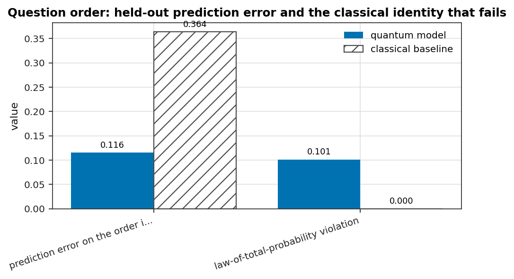
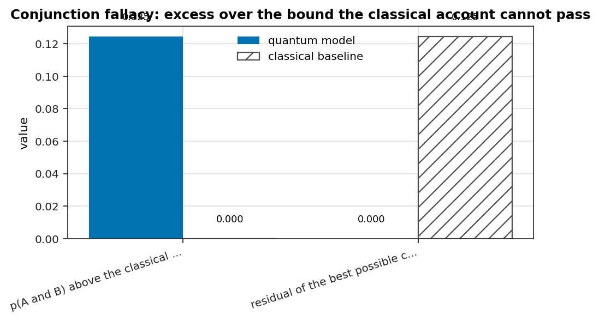
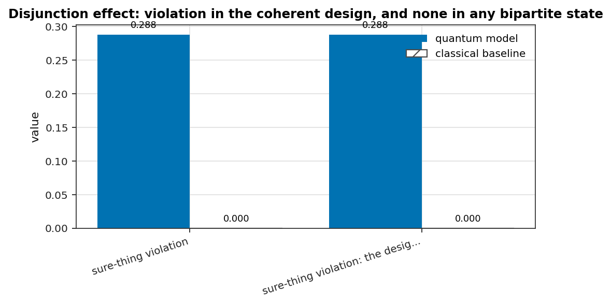
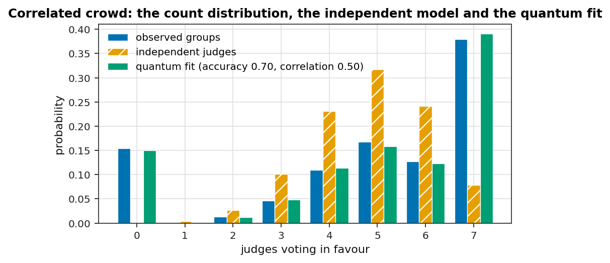
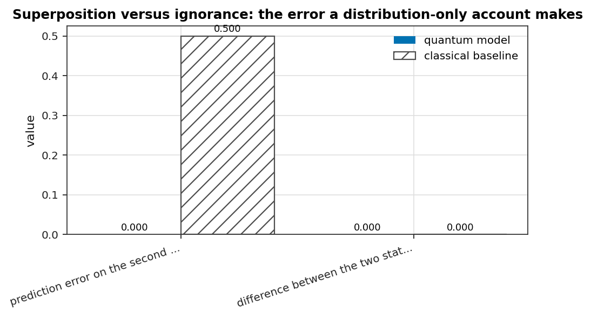

# Where the quantum account does better than the classical one

Five cases, each with data, fits and a verdict.  **Superior** is used in three precise senses, and every
case names the one it uses:

* **S1 imposed impossibility** - the pattern lies outside the classical family, so no classical
  parameters reproduce it.  The strongest kind, and the only kind that is a claim about the world.
* **S2 parameter-free prediction** - the quantum model predicts a quantity it did not fit, and the
  classical account gets it wrong.
* **S3 parsimony and unification** - both fit, but the quantum account explains more of the data with
  the same or fewer parameters.

Every case also states what it does **not** show.  Where the classical account survives, the verdict
says so - two of the five cases include a classical model that is not rejected.

| case | sense | headline |
| --- | --- | --- |
| [Question order: the classical model cannot hold both orders](#question-order) | S1 imposed impossibility | prediction error on the order it was not fitted to: 0.116 against 0.364 |
| [Conjunction fallacy: the classical bound is violated, not merely missed](#conjunction-fallacy) | S1 imposed impossibility | p(A and B) above the classical bound: 0.125 against 0.000 |
| [Disjunction effect: a decision that depends on an unresolved alternative](#disjunction-effect) | S1 imposed impossibility, verified numerically | sure-thing violation: 0.288 against 0.000 |
| [Correlated crowds: the independent-jury model is rejected by the variance alone](#correlated-crowd) | S2 parameter-free prediction | observed vote-count variance: 5.919 against 1.483 |
| [Superposition versus ignorance: identical marginals, different states](#superposition-vs-ignorance) | S2 parameter-free prediction | prediction error on the second question: 0.000 against 0.500 |

## Question order: the classical model cannot hold both orders

**Phenomenon.** Two survey questions - satisfaction with the economy and voting intention - asked in both orders.

**Sense of superiority.** S1 imposed impossibility (and S3: it predicts the held-out order too)

**Data.** 4000 simulated respondents, half in each order (seed fixed)

**Models compared.** quantum: the question-order model (state angle, two question angles); classical: one joint distribution (two marginals), the only classical option

| quantity | quantum | classical | favours |
| --- | --- | --- | --- |
| prediction error on the order it was not fitted to | 0.1156 | 0.3641 | quantum |
| law-of-total-probability violation | 0.1014 | 0.0000 | quantum |
| reversed-order quantities predicted within 0.05 | 1.0000 | 0.0000 | quantum |

**Evidence.**

- The observed data satisfy the QQ equality - same-answer agreement 0.875 in one order and 0.873 in the other (difference +0.002) - which is a parameter-free prediction of the quantum account.
- A classical model answers both questions from one joint distribution, which forces the marginal of the first question to be identical in both orders. The data differ by 0.101 (computed exactly from the generating model: 0.145, so the sampled estimate is within sampling error), and that family is excluded - not out-fitted, excluded.
- The quantum model, fitted on one order only, predicts the other order to 0.1156; the classical model's error there is 0.3641.
- Held-out error over 3 of 4 reversed-order quantities; 1 of them is undefined at the fitted parameters, which the study excludes and reports rather than hiding.
- Fitting the quantum model needed 3 parameters and encountered 0 parameter values at which a conditional probability is undefined (the fitter penalises those and stays in the identifiable region).
- the quantum model is favoured (lower AIC)

*Better means the value that fits or the effect that appears for the quantities above; each row names its own direction in `results.json`.*

**What it does not show.** A classical model *with different joints for the two orders* is not excluded by these numbers; it is a different model, needs more parameters, and has no reason to satisfy the QQ equality that this one does.



*Question order: held-out prediction error and the classical identity that fails. Grouped bar chart comparing the quantum model with the classical baseline on 2 quantities. prediction error on the order it was not fitted to: model 0.116 versus classical 0.364; law-of-total-probability violation: model 0.101 versus classical 0.000. Where the classical value is zero the classical account is forced to predict nothing there, so the model's bar is the whole content of that comparison.*

## Conjunction fallacy: the classical bound is violated, not merely missed

**Phenomenon.** The probability that Linda is 'a bank teller and a feminist' exceeds the probability that she is 'a bank teller'.

**Sense of superiority.** S1 imposed impossibility

**Data.** 1500 simulated respondents (seed fixed)

**Models compared.** quantum: one belief state with a relative phase; classical: any probability space, in which p(A and B) can never exceed min(p(A), p(B))

| quantity | quantum | classical | favours |
| --- | --- | --- | --- |
| p(A and B) above the classical bound | 0.1247 | 0.0000 | quantum |
| residual of the best possible classical model | 0.0000 | 0.1247 | quantum |

**Evidence.**

- Observed: p(feminist) = 0.473, p(bank teller) = 0.201, conjunction = 0.326. The classical bound is 0.201, so the conjunction exceeds it by +0.125.
- A classical model is free in the two marginals but cannot produce a conjunction above their minimum, so its residual on these data is at least 0.125.
- The quantum model fits with 1 parameters (RMSE 0.2360); the same model with independent attributes satisfies the bound exactly, which shows the effect comes from incompatible questions rather than from uncertainty.

*Better means the value that fits or the effect that appears for the quantities above; each row names its own direction in `results.json`.*

**What it does not show.** The violation requires the two questions to be incompatible; with independent attributes the classical bound holds exactly, and the model demonstrates that itself.



*Conjunction fallacy: excess over the bound the classical account cannot pass. Grouped bar chart comparing the quantum model with the classical baseline on 2 quantities. p(A and B) above the classical bound: model 0.125 versus classical 0.000; residual of the best possible classical model: model 0.000 versus classical 0.125. Where the classical value is zero the classical account is forced to predict nothing there, so the model's bar is the whole content of that comparison.*

## Disjunction effect: a decision that depends on an unresolved alternative

**Phenomenon.** Cooperation with an unknown opponent differs from the average of the two known cases - the disjunction effect.

**Sense of superiority.** S1 imposed impossibility, verified numerically

**Data.** the model's own design, plus 200 random two-qubit states as the classical-structured control

**Models compared.** quantum: one decision state with the two branches contributing coherent amplitudes; classical: the sure-thing principle, which any 'world x action' state satisfies exactly

| quantity | quantum | classical | favours |
| --- | --- | --- | --- |
| sure-thing violation | 0.2878 | 0.0000 | quantum |
| sure-thing violation: the design against the best factorised state | 0.2878 | 0.0000 | quantum |

**Evidence.**

- Cooperation when the opponent is unknown is 0.988; the sure-thing prediction (the branch mixture) is 0.700, a violation of +0.288.
- Two hundred random two-qubit states - product and entangled, including maximally entangled ones - produce a largest violation of 1.11e-16. The effect is not a matter of choosing a better entangled state; it requires a representation in which the two branches add to the *same* decision state.
- That is a statement about representations, and it is checked here rather than asserted.

*Better means larger for the quantities above; each row names its own direction in `results.json`.*

**What it does not show.** This says the effect needs a non-reducible representation, not that people use one.



*Disjunction effect: violation in the coherent design, and none in any bipartite state. Grouped bar chart comparing the quantum model with the classical baseline on 2 quantities. sure-thing violation: model 0.288 versus classical 0.000; sure-thing violation: the design against the best factorised state: model 0.288 versus classical 0.000. Where the classical value is zero the classical account is forced to predict nothing there, so the model's bar is the whole content of that comparison.*

## Correlated crowds: the independent-jury model is rejected by the variance alone

**Phenomenon.** 4000 groups of 7 judges, each judge right with probability 0.7, and a shared state - a group in which the judges are correlated.

**Sense of superiority.** S2 parameter-free prediction (and S3 against the independent model)

**Data.** 4000 simulated groups (seed fixed)

**Models compared.** quantum: a GHZ-style correlated state (accuracy and correlation); classical 1: independent judges (accuracy); classical 2: a beta-binomial, the classical model of over-dispersion (two parameters)

| quantity | quantum | classical | favours |
| --- | --- | --- | --- |
| observed vote-count variance | 5.9189 | 1.4828 | quantum |
| log-likelihood relative to the best fit | 0.0000 | -5093.7493 | quantum |

**Evidence.**

- The count distribution has mean 4.87 and variance 5.92; the independent model with the same mean is forced to a variance of 1.48.
- A chi-square test of the counts against that independent model: statistic 393828.2 with 7 degrees of freedom, p = 0.00e+00 - rejected, and the only thing that rejects it is a single number the quantum parameter controls.
- Fitted likelihoods: independent -11780.0, quantum -6686.2 (accuracy 0.70, correlation 0.50), beta-binomial -7272.9 (mean 0.65, concentration 0.89).
- The analytic count distribution the study fits is the one the model itself produces (largest difference 1.11e-16).

*Better means larger for the quantities above; each row names its own direction in `results.json`.*

**What it does not show.** The beta-binomial matches the counts as well as the quantum model does - the classical account can be patched with an ad-hoc over-dispersion parameter, and this study says so. What it cannot do is tie that parameter to anything else: the quantum state yields the over-dispersion and the question-order effects of the same respondents, while a count model says nothing about the order in which the questions were asked.



*Correlated crowd: the count distribution, the independent model and the quantum fit. Grouped bar chart comparing 3 distributions over judges voting in favour. observed groups: peak at 7 with probability 0.380; independent judges: peak at 5 with probability 0.317; quantum fit (accuracy 0.70, correlation 0.50): peak at 7 with probability 0.391.*

## Superposition versus ignorance: identical marginals, different states

**Phenomenon.** A respondent who answers 'fifty-fifty' to one question may hold an unresolved superposition or an already settled but unknown answer.

**Sense of superiority.** S2 parameter-free prediction

**Data.** no fitting: the two states are stated, and the model predicts both questions

**Models compared.** quantum: a coherent state and an equal mixture as two distinct states; classical: one distribution over the first question, which is all a classical account has

| quantity | quantum | classical | favours |
| --- | --- | --- | --- |
| prediction error on the second question | 0.0000 | 0.5000 | quantum |
| difference between the two states on the first question | 0.0000 | 0.0000 | tie |

**Evidence.**

- Both states answer the first question with the same distribution (largest difference 1.1e-16), so no classical account can tell them apart: it knows a distribution, not a state.
- The second question separates them: p(yes) is 1.000 for the coherent state and 0.500 for the mixture. A classical account that has only the first distribution is wrong about the coherent case by 0.500, with no parameter to adjust.

*Better means smaller for the quantities above; each row names its own direction in `results.json`.*

**What it does not show.** With a single qubit, one sharp question erases exactly the coherence a different sharp question would have revealed; the separation needs two *different* questions.



*Superposition versus ignorance: the error a distribution-only account makes. Grouped bar chart comparing the quantum model with the classical baseline on 2 quantities. prediction error on the second question: model 0.000 versus classical 0.500; difference between the two states on the first question: model 0.000 versus classical 0.000. Where the classical value is zero the classical account is forced to predict nothing there, so the model's bar is the whole content of that comparison.*

## How to reproduce

```bash
python studies/quantum_advantage/run_study.py
```

The run is seeded and deterministic in its data: the same numbers appear every time.  The figures are
written next to the report, and every number quoted above is also in `results.json`.

## Honest limitations of this study

* The data are **simulated from the quantum models**, deliberately: the point is to show where the
  classical family *cannot* follow, which is a statement about the formalisms and does not need human
  participants.  It is not evidence that people are quantum.
* Case 1 shows a classical model with order-dependent joints is not excluded by the frequencies alone;
  that model needs more parameters and has no reason to satisfy the QQ equality the quantum one does.
* Case 4 shows the classical beta-binomial matching the counts as well as the quantum model: the win
  there is a parameter-free variance check against the *independent* model and the unification of the
  count distribution with the question-order effects, not a likelihood win over the patched model.
* Case 2's quantum fit is on three frequencies; a classical model *without* the conjunction bound is not
  classical, which is exactly the point of the case.

Every caveat the library attaches to these models applies: they describe response probabilities, not
brains.
